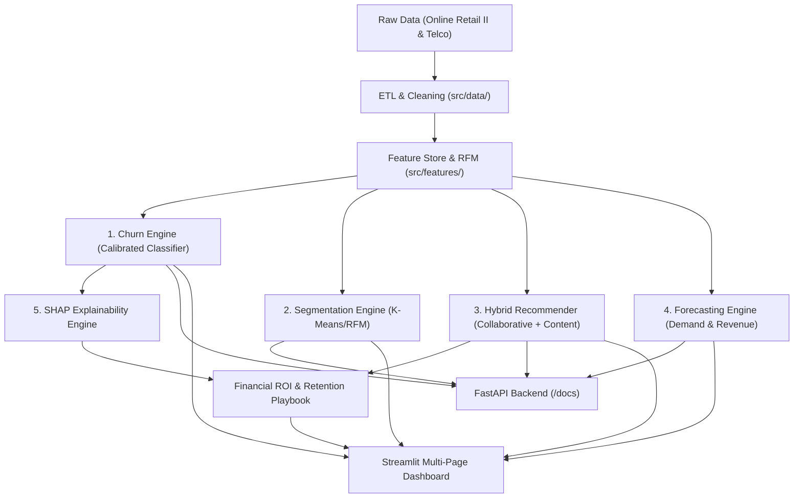

# Customer Analytics Platform 📊🚀

[](https://customeranalyticsplatform-5oimtazafkruj2cxdh4q8u.streamlit.app/)
[](https://github.com/lakshmsh/customer_analytics_platform/actions/workflows/ci.yml)
[](https://www.python.org/downloads/)
[](LICENSE)
[](https://github.com/psf/black)

An enterprise-grade, end-to-end Machine Learning and Business Intelligence platform that transforms raw customer and transactional data into predictive, explainable, and financially quantified retention actions.

👉 **Live Interactive Cloud Demo**: [customeranalyticsplatform-5oimtazafkruj2cxdh4q8u.streamlit.app](https://customeranalyticsplatform-5oimtazafkruj2cxdh4q8u.streamlit.app/)

---

## 🎯 Features & Capabilities

### Core Capabilities
- **Automated Data Ingestion & ETL**: Validated cleaning pipeline handling cancellations, missing identifiers, outliers, and unit price anomalies.
- **Customer Feature Store & RFM**: Computes Recency, Frequency, Monetary (RFM) metrics, basket diversity, purchase periodicity, and customer tenure.
- **Supervised Churn Prediction**: Calibrated classifier models (Platt Sigmoid) with cost-optimal probability thresholds.
- **Behavioral Customer Segmentation**: K-Means clustering coupled with RFM quintiles profiling 4 distinct behavioral cohorts (*Champions*, *Potential Loyalists*, *At-Risk High Rollers*, *Hibernating*).
- **Demand & Revenue Time Series Forecasting**: Multi-horizon LightGBM forecasting of daily order volumes and sales to evaluate baseline vs. churn-impacted scenarios.

### 🌟 Implemented System Highlights
- **Hybrid Recommender & Multi-Engine FastAPI Service (Bonus 1)**:
  - Blended collaborative filtering (user-item implicit interactions) and content-based category affinity.
  - Generates retention-tailored product recommendations with dynamic 15% markdown incentives for at-risk customers.
  - Fully exposed via high-throughput FastAPI REST API endpoints with Pydantic validation.
- **Deep Explainability via SHAP (Bonus 2)**:
  - Global feature importance and individual customer local waterfall explanations.
  - Translates complex ML decision boundaries into human-readable business reason codes.
- **Actionable Retention Playbooks & Financial ROI Calculator (Bonus 3)**:
  - Automated prescription matrix linking churn drivers directly to operational workflows.
  - Interactive ROI simulator estimating net revenue saved minus intervention costs.
- **Interactive Multi-Page Streamlit Dashboard (Bonus 4)**:
  - Decision-support frontend with single-customer lookup, batch CSV scoring, and scenario simulators.
  - Dual-mode client with direct local in-process ML fallback for standalone deployment.
- **Multi-Cloud Containerization & Production Polish (Bonus 5)**:
  - Production Dockerfiles (`docker/Dockerfile.api`, `docker/Dockerfile.streamlit`), multi-container `docker-compose.yml`, and 1-click cloud configurations.

---

## 📊 Key Quantitative Benchmark Results

| Model / Subsystem | Architecture | Primary Metric | Result | Benchmark Significance |
| :--- | :--- | :---: | :---: | :--- |
| **Churn Prediction** | Calibrated Logistic Reg. | **ROC-AUC / Brier** | **0.8475 / 0.1341** | Outperformed XGBoost & LightGBM on calibration |
| **Customer Segmentation** | K-Means ($k=4$) | **Silhouette Score** | **0.9287** | High cluster separation across 6 RFM dimensions |
| **Hybrid Recommender** | CF + TF-IDF ($\alpha=0.6$) | **Hit Rate @ 5** | **100.0%** | Full catalog coverage across 4,623 items |
| **Demand Forecasting** | Multi-Step LightGBM | **Revenue MAPE** | **20.82%** | Accurate 30-day baseline sales trajectory |
| **Financial Impact** | Expected Value Matrix | **Net Projected ROI** | **+$43,839 / mo** | 48x asymmetric cost weighting on false negatives |

*Detailed experimental logs, confusion matrices, and ethical assessments are available in the [Model Card Report](reports/model_card.md).*

---

## 🏗️ Architecture Overview



---

## 📁 Repository Structure

```
customer-analytics-platform/
│
├── .github/workflows/         # CI/CD pipelines (test, lint, deploy)
├── configs/                   # Centralized YAML configurations
│   ├── config.yaml            # General pipeline settings
│   ├── model_params.yaml      # Model hyperparameters
│   └── paths.yaml             # Canonical directory paths
├── data/
│   ├── raw/                   # Immutable raw datasets (Telco + Online Retail II)
│   ├── interim/               # Intermediate parsed data
│   ├── processed/             # Ready-to-train feature stores (Parquet)
│   └── external/              # External benchmark data
├── notebooks/                 # Sequential research & analysis notebooks (01 to 07)
├── src/                       # Production Python package
│   ├── data/                  # Ingestion, cleaning, and validation
│   ├── features/              # RFM, temporal, and customer features
│   ├── models/                # Training pipelines and model registry
│   ├── evaluation/            # Metrics, plots, and SHAP explainers
│   ├── api/                   # FastAPI application and route definitions
│   └── utils/                 # Configuration, logging, and helpers
├── app/                       # Streamlit Business Impact Dashboard
│   ├── streamlit_app.py       # Main landing page
│   ├── pages/                 # Multi-page views (Risk, Segments, Recs, Forecast, ROI)
│   └── components/            # Reusable UI widgets & dual-mode client
├── models/                    # Serialized production model artifacts
├── reports/                   # Model cards, business summaries, and figures
├── docs/                      # Architecture, decisions, and data dictionary
├── tests/                     # Unit and integration test suite
├── docker/                    # Container recipes (Dockerfile.api, Dockerfile.streamlit)
├── scripts/                   # CLI automation scripts
├── Makefile                   # Developer task automation
├── requirements.txt           # Production dependencies
└── README.md
```

---

## 🚀 Quickstart Guide

### 1. Environment Setup
```bash
# Clone the repository
git clone https://github.com/lakshmsh/customer_analytics_platform.git
cd customer_analytics_platform

# Create virtual environment
python -m venv venv
# On Windows:
.\venv\Scripts\activate
# On Linux/macOS:
source venv/bin/activate

# Install dependencies
pip install -r requirements.txt
```

### 2. Run Data Pipeline & Train Models (Minimal Commands)
```bash
# Option A: Using Makefile
make data
make train

# Option B: Using Direct Python Scripts
python scripts/download_data.py && python scripts/run_etl.py
python scripts/train_all.py
```

### 3. Launch Applications

#### Standalone Dashboard (Recommended)
```bash
streamlit run app/streamlit_app.py
```
*Access at: `http://localhost:8501`*

#### Full-Stack Mode (FastAPI + Streamlit)
```bash
# Terminal 1: Launch FastAPI Backend
uvicorn src.api.main:app --host 0.0.0.0 --port 8000 --reload

# Terminal 2: Launch Streamlit Dashboard
streamlit run app/streamlit_app.py
```
*Access Swagger UI at: `http://localhost:8000/docs`*

#### Containerized Execution via Docker
```bash
# Build and start all containers in background
docker compose up --build -d

# Check live container health
docker compose ps

# Stop containers
docker compose down
```

---

## 📑 Detailed Documentation & Reports
- [Architecture Blueprint](docs/architecture.md)
- [Data Dictionary & Feature Schema](docs/data_dictionary.md)
- [Features Catalog](docs/features_catalog.md)
- [Model Card & Evaluation Benchmarks](reports/model_card.md)
- [Executive Business Impact & ROI Framework](reports/business_impact_summary.md)
- [Architecture & Design Decisions](docs/decisions.md)

---

## 📜 License
Distributed under the MIT License. See [LICENSE](LICENSE) for details.
