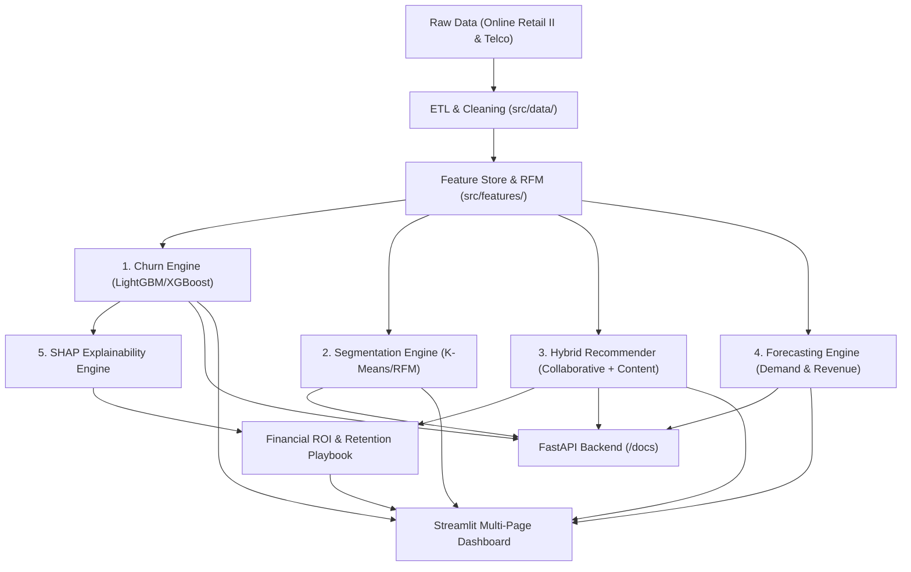

# Customer Analytics Platform 📊🚀

[](https://github.com/laksh/customer-analytics-platform/actions/workflows/ci.yml)
[](https://www.python.org/downloads/)
[](LICENSE)
[](https://github.com/psf/black)

An enterprise-grade, end-to-end Machine Learning and Business Intelligence platform that transforms raw customer and transactional data into predictive, explainable, and financially quantified retention actions.

---

## 🎯 Features & Capabilities

### Core Capabilities
- **Automated Data Ingestion & ETL**: Validated cleaning pipeline handling cancellations, missing identifiers, outliers, and unit price anomalies.
- **Customer Feature Store & RFM**: Computes Recency, Frequency, Monetary (RFM) metrics, basket diversity, purchase periodicity, and customer tenure.
- **Supervised Churn Prediction**: LightGBM/XGBoost models with calibrated probability scoring and business-cost threshold tuning.
- **Behavioral Customer Segmentation**: K-Means clustering coupled with RFM quintiles to profile distinct behavioral cohorts (*Champions*, *Loyalists*, *At Risk*, *Hibernating*).
- **Demand & Revenue Time Series Forecasting**: Multi-horizon forecasting of daily order volumes and revenue to assess baseline vs. at-risk scenarios.

### 🌟 Bonus Points Implemented
- **Bonus 1 — Hybrid Recommender & Multi-Engine FastAPI Service**:
  - Blended collaborative filtering (user-item implicit interactions) and content-based category affinity.
  - Generates retention-tailored product recommendations for at-risk customers.
  - Fully exposed via high-throughput FastAPI REST API endpoints with Pydantic validation.
- **Bonus 2 — Deep Explainability via SHAP**:
  - Global feature importance and individual customer local waterfall explanations.
  - Translates complex ML decision boundaries into human-readable business reason codes.
- **Bonus 4 — Actionable Retention Playbooks & Financial ROI Calculator**:
  - Automated prescription matrix linking churn drivers to specific intervention playbooks.
  - Interactive ROI simulator estimating net revenue saved minus intervention costs.
- **Bonus 5 — Interactive Streamlit Dashboard & Docker Deployment**:
  - Multi-page operational and executive dashboard with single-customer lookup, batch CSV scoring, and scenario simulators.
  - Multi-container Docker deployment (`docker-compose.yml`) for seamless reproducibility.

---

## 🏗️ Architecture Overview



---

## 📁 Repository Structure

```
customer-analytics-platform/
│
├── .github/workflows/         # CI/CD pipelines (test, lint, deploy)
├── configs/                   # Centralized YAML configurations
│   ├── config.yaml            # General pipeline settings
│   ├── model_params.yaml      # Model hyperparameters
│   └── paths.yaml             # Canonical directory paths
├── data/
│   ├── raw/                   # Immutable raw datasets
│   ├── interim/               # Intermediate parsed data
│   ├── processed/             # Ready-to-train feature sets
│   └── external/              # External benchmark data
├── notebooks/                 # Sequential research & analysis notebooks
├── src/                       # Production Python package
│   ├── data/                  # Ingestion, cleaning, and validation
│   ├── features/              # RFM, temporal, and customer features
│   ├── models/                # Training pipelines and model registry
│   ├── evaluation/            # Metrics, plots, and SHAP explainers
│   ├── api/                   # FastAPI application and route definitions
│   └── utils/                 # Configuration, logging, and helpers
├── app/                       # Streamlit Business Impact Dashboard
│   ├── streamlit_app.py       # Main landing page
│   ├── pages/                 # Multi-page views (Risk, Segments, Recs, Forecast, ROI)
│   └── components/            # Reusable UI widgets
├── models/                    # Serialized production model artifacts
├── reports/                   # Model cards, business summaries, and figures
├── docs/                      # Architecture, decisions, and data dictionary
├── tests/                     # Unit and integration test suite
├── docker/                    # Containerization setup
├── scripts/                   # CLI automation scripts
├── Makefile                   # Developer task automation
├── requirements.txt           # Production dependencies
└── README.md
```

---

## 🚀 Quickstart Guide

### 1. Environment Setup
```bash
# Clone the repository
git clone https://github.com/laksh/customer-analytics-platform.git
cd customer-analytics-platform

# Create virtual environment
python -m venv venv
# On Windows:
.\venv\Scripts\activate
# On Linux/macOS:
source venv/bin/activate

# Install dependencies
pip install -r requirements.txt
```

### 2. Run Data Pipeline & Train Models
```bash
# Download and clean data
python scripts/download_data.py
python scripts/run_etl.py

# Train all machine learning models
python scripts/train_all.py
```

### 3. Launch Applications
```bash
# Launch FastAPI Backend
uvicorn src.api.main:app --host 0.0.0.0 --port 8000 --reload

# Launch Streamlit Dashboard
streamlit run app/streamlit_app.py
```

---

## 📜 License
Distributed under the MIT License. See [LICENSE](file:///C:/Users/laksh/OneDrive/Desktop/projects/customer_analytics_platform/LICENSE) for details.
