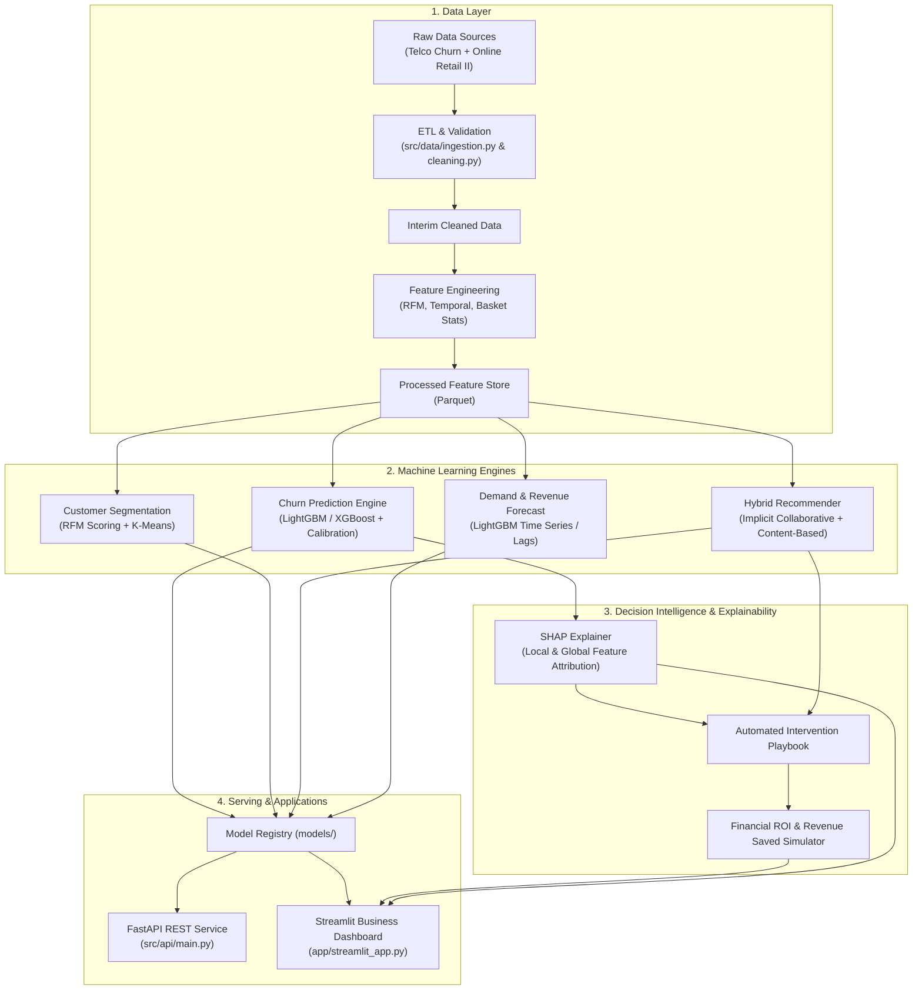

# Customer Analytics Platform - System Architecture

## 1. System Overview

The **Customer Analytics Platform** is an enterprise-grade machine learning system designed to analyze transactional e-commerce and subscription customer data, predict churn risk, perform behavioral segmentation, offer personalized product recommendations, forecast future demand/revenue, and generate explainable, financially quantified retention interventions.

## 2. Core Subsystems

### 2.1 Ingestion & Feature Engineering
- **Transactional Data Processing**: Clean transaction anomalies (cancelled orders `C*`, missing customer IDs, negative prices/quantities).
- **Customer Feature Store**: Aggregates customer-level RFM (Recency, Frequency, Monetary), inter-purchase intervals, category affinities, basket variance, and tenure.

### 2.2 Machine Learning Engines
1. **Churn Prediction**:
   - Supervised binary classification on tabular features.
   - Evaluated on ROC-AUC, PR-AUC, Brier Score, and calibrated probabilities.
2. **Customer Segmentation**:
   - RFM quintile scoring coupled with K-Means clustering.
   - Actionable behavioral personas: *Champions*, *Loyalists*, *At Risk*, *Hibernating*.
3. **Hybrid Recommender**:
   - Blends implicit collaborative filtering (user-item interactions) with content/category affinities.
   - Tailored specifically to recommend churn-mitigation products.
4. **Demand & Revenue Forecast**:
   - Multi-horizon time series forecasting.
   - Calculates baseline vs. churn-impacted revenue projections.

### 2.3 Explainability & Business ROI Engine
- **SHAP Integration**: Explains why individual customers are flagged as high risk.
- **Intervention Playbook**: Maps top churn drivers to specific retention workflows.
- **ROI Formula**:
  $$\text{Net Revenue Saved} = \sum_{i \in \text{AtRisk}} \left( \text{CLV}_i \times P(\text{Churn}_i) \times \text{SuccessRate} \right) - \text{InterventionCost}$$

### 2.4 Serving & Presentation
- **FastAPI Endpoints**: `/churn/predict`, `/segment/profile`, `/recommend/items`, `/forecast/revenue`.
- **Streamlit Dashboard**:
  - Page 1: Churn Risk Prediction & Customer Lookup
  - Page 2: Customer Behavioral Segments
  - Page 3: Smart Product Recommendations
  - Page 4: Demand & Revenue Forecast
  - Page 5: Executive Business Impact & ROI Simulator
