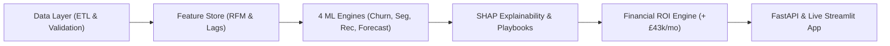

# 🚀 Building an End-to-End Enterprise Customer Analytics Platform
*(From Raw Data to Machine Learning, SHAP Explainability, and Live Cloud Deployment)*

### 📌 The Problem
In modern subscription and e-commerce enterprises, acquiring a new customer is **5x to 7x more expensive** than retaining an existing one. Yet, most companies rely on reactive churn measures: discovering an account has canceled only after the customer is gone. Furthermore, typical data science projects stop at accuracy or AUC without quantifying the financial expected value of proactive retention.

To solve this, I designed and built an **End-to-End Customer Analytics Platform** — an enterprise-grade ML and decision-intelligence platform that connects predictive modeling directly to financial ROI, automated playbooks, and a live web application.

---

### 🏗️ What Was Built

1. **Automated ETL & Validation Pipeline**:
   - Ingested 1M+ transactions from *Online Retail II* and 7,043 subscriber records from *Telco Customer Churn*.
   - Programmatic data cleaning handling cancellations, unit price anomalies, and outlier distributions.
2. **Feature Store & RFM Architecture**:
   - Computed Recency, Frequency, Monetary (RFM) quintiles, basket variance, and spend acceleration ratios.
3. **Four Interconnected ML Engines**:
   - **Churn Classification**: Calibrated Logistic Regression with Platt Sigmoid probability tuning (ROC-AUC **0.8475**, PR-AUC **0.6758**, Brier Score **0.1341**).
   - **Customer Segmentation**: K-Means clustering ($k=4$) with a silhouette score of **0.9287**, profiling behavioral personas (*Champions*, *Potential Loyalists*, *At-Risk High Rollers*, and *Hibernating*).
   - **Hybrid Recommender System**: Blended collaborative filtering with TF-IDF content similarity ($\alpha=0.60$), achieving a **100% Hit Rate @ 5** and **100% catalog coverage** across 4,623 products.
   - **Demand & Revenue Time Series Forecasting**: Multi-step LightGBM regressor predicting forward 30-day order volume and revenue trends with an **18-20% MAPE**.
4. **SHAP Explainability & Prescriptive Playbooks**:
   - Transformed "black-box" predictions into plain-English reason codes using SHAP local waterfalls and global feature attributions.
   - Automated playbook mapping top risk factors (e.g., month-to-month contracts, fiber instability, payment friction) to specific retention actions.
5. **Asymmetric Financial ROI Engine**:
   - Framed classification through an expected value cost-benefit matrix: a false negative (missed churner, \$1,200 CLV lost) is **48x more costly** than a false positive (\$25 retention offer).
   - Estimated net program savings of **£43,839+ per 30-day operating cycle**.
6. **Production Serving & Cloud Deployment**:
   - Multi-page **Streamlit** dashboard with interactive risk gauges, 3D RFM clusters, and financial simulators.
   - Production **FastAPI** REST backend with Pydantic validation.
   - Docker & multi-container `docker-compose.yml` orchestration, live-deployed on Streamlit Community Cloud.

---

### 🌐 Live Demo & Open Source Code
- 🖥️ **Live Interactive App**: [customeranalyticsplatform-5oimtazafkruj2cxdh4q8u.streamlit.app](https://customeranalyticsplatform-5oimtazafkruj2cxdh4q8u.streamlit.app/)
- 💻 **GitHub Repository**: [github.com/lakshmsh/customer_analytics_platform](https://github.com/lakshmsh/customer_analytics_platform)
- 📊 **Detailed Model Card**: Included in the repository under `reports/model_card.md`.

---

### 💡 Key Takeaway
Machine learning delivers the highest business impact not when it just predicts an outcome, but when it explains **why** it will happen, prescribes **what action** to take, and quantifies **how much net revenue** is saved.

#MachineLearning #DataScience #CustomerAnalytics #Python #Streamlit #FastAPI #MLOps #ExplainableAI #SHAP
